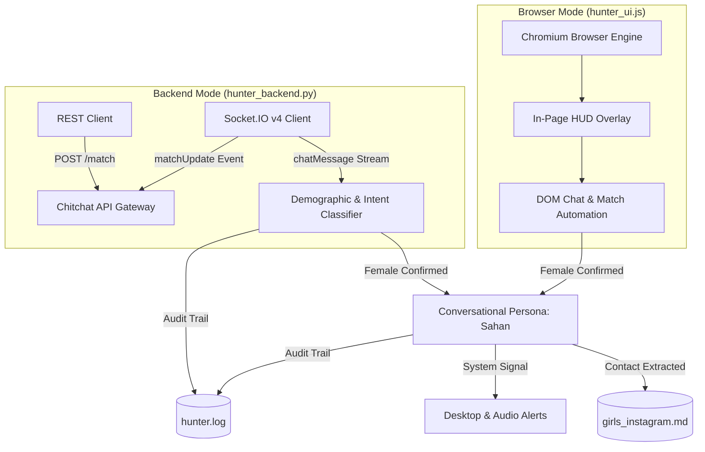

<p align="center">
  <a href="https://chitchat.gg" target="_blank" rel="noopener noreferrer">
    
  </a>
</p>

<h1 align="center">Chitchat Chick Hunt</h1>

<p align="center">
  High-performance dual-engine automation framework and natural conversation bot for <a href="https://chitchat.gg">Chitchat.gg</a>.
</p>

<p align="center">
  <a href="https://www.python.org/"></a>
  <a href="https://nodejs.org/"></a>
  <a href="https://socket.io/"></a>
  <a href="LICENSE"></a>
</p>

<p align="center">
  <a href="#overview">Overview</a> &bull;
  <a href="#dual-engine-architecture">Architecture</a> &bull;
  <a href="#key-capabilities">Capabilities</a> &bull;
  <a href="#project-structure">Structure</a> &bull;
  <a href="#installation">Installation</a> &bull;
  <a href="#usage">Usage</a> &bull;
  <a href="#session-logging">Logging</a> &bull;
  <a href="#verification-tests">Testing</a>
</p>

---

## Overview

**Chitchat Chick Hunt** is a modular framework for automated matchmaking, demographic screening, and natural dialogue on Chitchat.gg. Designed with reliability and performance in mind, it supports two independent runtime implementations:

1. **Headless Backend Engine (`hunter_backend.py`)**: A browser-independent, event-driven client using Python, `requests`, and real-time Socket.IO v4 over WebSockets. Operates with sub-second matchmaking cycles and negligible resource consumption (~15 MB RAM).
2. **Visual Browser Engine (`hunter_ui.js`)**: A Chromium-based browser client powered by Puppeteer with stealth patches and an in-page Head-Up Display (HUD) overlay for real-time monitoring and manual takeover.

Both engines integrate an adaptive conversational state machine, automated contact harvesting, and unified audit logging.

---

## Dual-Engine Architecture

| Feature | Backend Engine (`hunter_backend.py`) | Browser Engine (`hunter_ui.js`) |
| :--- | :--- | :--- |
| **Runtime** | Python 3.10+ (REST + Socket.IO v4) | Node.js 18+ (Puppeteer + Stealth) |
| **Interface** | CLI terminal feed (color-coded) | Chrome browser window with in-page HUD |
| **Resource Profile** | ~15 MB RAM, 0% GPU | ~120 MB RAM, standard browser rendering |
| **Matchmaking Latency** | Sub-second direct API handshakes | DOM-driven browser cycle speed |
| **Control Modes** | Autonomous terminal process | Interactive HUD (Pause, Resume, Manual Takeover) |
| **Persona Engine** | Sahan, 20 (Polite, conversational) | Sahan, 20 (Polite, conversational) |
| **Contact Storage** | Structured Markdown (`girls_instagram.md`) | Structured Markdown (`girls_instagram.md`) |
| **Session Logging** | Timestamped audit log (`hunter.log`) | Timestamped audit log (`hunter.log`) |
| **System Alerts** | Terminal bell and desktop notification | Desktop notification and visual HUD badge |



---

## Key Capabilities

### 1. High-Precision Demographic Screening
- **Username Heuristics**: Automatically screens male usernames using tokenized keyword and name matching before initiating chat cycles.
- **Intent vs. Identity Disambiguation**: Differentiates between screening questions (e.g., `"f?"`, `"m or f?"`) and declarative gender confirmations (`"19f"`, `"im a girl"`), preventing false matches.
- **Safety Boundaries**: Enforces immediate termination upon detecting any underage indicators (`< 18`).

### 2. Adaptive Conversational Persona
- **Persona Context**: Sahan, 20, from Sri Lanka. Maintains a respectful, polite, and natural conversational cadence.
- **Dynamic Rapport Flow**: Transitions naturally across conversational phases:
  1. Initial greeting and reciprocal check-in.
  2. Geographic origin and casual banter.
  3. Lifestyle and daily vibe exchange.
  4. Polite social handle transition.
- **Continuous State Handling**: Accommodates brief answers, greeting counters, and conversational pivots without stalling.

### 3. Session Logging and Inspection
Both engines log all inbound and outbound events to `hunter.log` in real time:
- Timestamped connection events and match durations.
- Raw message logs with sender attribution.
- Skip rationales (username rule, demographic keyword, timeout, or user disconnect).
- Successful handle acquisitions with extracted profile metadata.

---

## Project Structure

```
.
├── hunter_backend.py       # Headless backend client (Python + Socket.IO v4)
├── hunter_ui.js            # Visual browser client with HUD overlay (Node.js)
├── hunter.py               # Backend runner entrypoint alias
├── chitchat_api.py         # Socket.IO v4 and REST gateway client
├── cookies.json            # Authentication credentials (git-ignored)
├── cookies.example.json    # Credential schema template
├── girls_instagram.md      # Harvested contacts directory
├── hunter.log              # Real-time session execution log (git-ignored)
├── assets/                 # Vector and raster brand assets
│   ├── chitchat-logo.png   # High-resolution raster logo (512x512)
│   └── chitchat-logo.svg   # Scalable vector logo
├── docs/                   # System and protocol specifications
│   ├── endpoints_doc.md    # REST and WebSocket network specifications
│   └── texting_patterns.md # Conversational state logic
└── tests/                  # Verification test suite
    ├── test_backend.py     # Backend connection and queue handshake test
    ├── test_ui.js          # Browser initialization and DOM selector test
    └── test_timeout.js     # Timeout and message retention benchmark
```

---

## Installation

### Prerequisites
- Python 3.10 or higher
- Node.js 18 or higher
- Google Chrome (required for Visual UI mode)

### Setup Steps

1. Clone the repository:
   ```bash
   git clone https://github.com/dulithdivisekara/chitchat-chick-hunt.git
   cd chitchat-chick-hunt
   ```

2. Install Python dependencies:
   ```bash
   pip install -r requirements.txt
   ```

3. Install Node.js dependencies:
   ```bash
   npm install
   ```

4. Configure session credentials:
   ```bash
   cp cookies.example.json cookies.json
   ```
   Populate `cookies.json` with valid session values (`token`, `__Secure-text-session`, and `cf_clearance`) retrieved from your browser storage settings.

---

## Usage

### Headless Backend Mode
Recommended for high-throughput automated execution:
```bash
python3 hunter_backend.py
# or
npm run backend
```

Example terminal output:
```text
[✓] Authenticated successfully as: SandunLK (ID: 6ae59ec84f15580c26fd612b)
[✓] Real-time Socket.IO connected!

────────────────── [ Match #1 ] ──────────────────
[*] Connected with: @contemporary_user
[You (Sahan)]: "heyy :) how's your day going?"
[@contemporary_user]: "m"
[SKIP] Male detected ("m"). Skipping immediately...

────────────────── [ Match #2 ] ──────────────────
[*] Connected with: @chloe_xox
[You (Sahan)]: "heyy :) how's your day going?"
[@chloe_xox]: "19f cali, doing good"
[GIRL CONFIRMED] Screening answer: "19f cali, doing good"
[You (Sahan)]: "heyy nice to meet u :) how's everything in Cali?"
[@chloe_xox]: "it's sunny haha where u from?"
[You (Sahan)]: "i'm Sahan, from Sri Lanka! what do u usually do around there?"
[@chloe_xox]: "beach mostly! u got insta?"
[You (Sahan)]: "yeah i do! what's your @? i'll add u"
[@chloe_xox]: "it's @chloe.la"
INSTAGRAM CAPTURED: @chloe.la
Stored in: girls_instagram.md
```

### Visual Browser Mode
Launches Chromium with an on-screen control panel:
```bash
node hunter_ui.js
# or
npm run ui
```

To run the browser mode headlessly without a display window:
```bash
npm run ui:headless
```

**HUD Controls:**
- **Status Indicator**: Displays real-time operational state (Lobby, Screening, Chatting, Paused).
- **Session Metrics**: Counters tracking males skipped, girls confirmed, and profiles stored.
- **Pause / Resume**: Pauses cycle transitions to review dialogue.
- **Manual Takeover**: Toggles automated response generation off to allow manual user interaction.
- **Skip**: Immediately terminates the active session and transitions to the next queue candidate.

---

## Session Logging

Execution logs are appended to `hunter.log` automatically. Each entry records the timestamp, event category, participant identifiers, and message content:

```text
[2026-11-02 00:15:10] MATCH_START: @partner_name (Conv ID: 6ae59ec8...)
[2026-11-02 00:15:11] OUTBOUND: [You (Sahan)]: "heyy :) how's your day going?"
[2026-11-02 00:15:13] INBOUND: [@partner_name]: "M"
[2026-11-02 00:15:13] SKIP_MALE_CHAT: @partner_name ("M")
[2026-11-02 00:15:14] MATCH_START: @chloe_xox (Conv ID: 7bf81da2...)
[2026-11-02 00:15:16] CONFIRMED_GIRL: @chloe_xox (19f cali)
[2026-11-02 00:15:28] INSTA_CAPTURED: @chloe.la from @chloe_xox | Age: 19 | Location: Cali | Interests: beach
```

To monitor the session stream in real time:
```bash
tail -f hunter.log
```

---

## Harvested Contact Directory

Captured profiles are formatted in [`girls_instagram.md`](girls_instagram.md):

| # | Instagram Handle | Profile Link | Chitchat Username | Age | Location / Country | Interests & Highlights | Chat Notes | Date & Time |
|:---:|---|---|---|:---:|---|---|---|---|
| 1 | `@chloe.la` | [chloe.la](https://instagram.com/chloe.la) | @chloe_xox | 19 | Cali | beach | friendly, fast reply | 2026-11-02 00:15 |

---

## Verification Tests

The repository includes a comprehensive test suite covering API connectivity, WebSocket lifecycles, and DOM selectors:

```bash
# Verify Backend REST and Socket.IO handshake
npm run test:backend

# Verify Browser automation and DOM bindings
npm run test:ui

# Verify Timeout duration and anti-skip logic
npm run test:timeout
```

---

## Security and Compliance

- **No Credential Exposure**: Sensitive cookies, tokens, and active session files (`cookies.json`, `hunter.log`) are strictly excluded via `.gitignore`.
- **Underage Safety Check**: Active detection stops and disconnects matches involving minors.
- **Humanized Keystroke Timing**: Random delays and typing indications prevent platform overload.

---

## License

This project is licensed under the [MIT License](LICENSE). It is intended for protocol research, network analysis, and automation engineering.