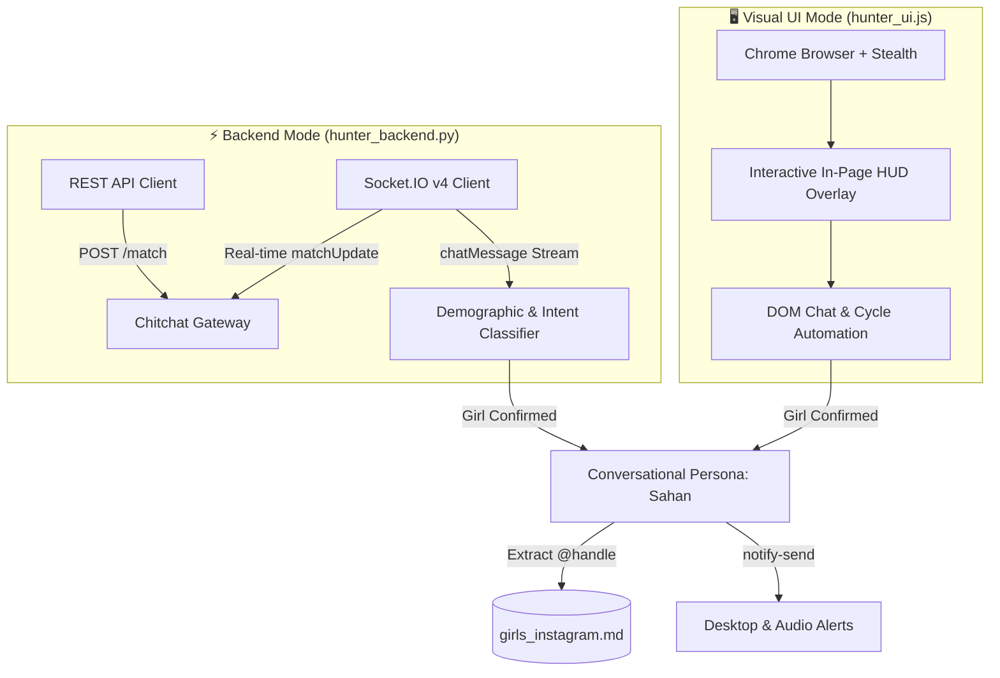

<div align="center">

<a href="https://chitchat.gg" target="_blank" rel="noopener noreferrer">
  
</a>

# Chitchat Automation Suite

**High-Performance Dual-Mode Automation Framework & Conversational Intelligence Engine for [Chitchat.gg](https://chitchat.gg)**

[](https://chitchat.gg)
[](https://www.python.org/)
[](https://nodejs.org/)
[](https://socket.io/)
[](#-two-hunting-modes)
[](LICENSE)
[](#)

<p align="center">
  <a href="#-two-hunting-modes">Modes</a> •
  <a href="#-architecture--protocols">Architecture</a> •
  <a href="#-project-structure">Structure</a> •
  <a href="#-quick-start">Quick Start</a> •
  <a href="#-usage-guide">Usage Guide</a> •
  <a href="#-test-suite">Testing</a> •
  <a href="#-safety--compliance">Safety</a>
</p>

</div>

---

## 📖 Overview

The **Chitchat Automation Suite** is an advanced dual-engine client engineered for automated matchmaking, demographic screening, and natural dialogue on [Chitchat.gg](https://chitchat.gg).

It operates in two distinct operational paradigms:
1. **⚡ Headless Backend Engine (`hunter_backend.py`)**: A 100% browser-free, event-driven client using Python, `requests`, and real-time `Socket.IO v4` over WebSockets for ultra-low latency, sub-second cycle speeds, and minimal resource consumption.
2. **🖥️ Visual UI Browser Engine (`hunter_ui.js`)**: A Chromium-based browser bot powered by Puppeteer with anti-detection flags and an interactive on-screen floating Head-Up Display (HUD) overlay for real-time monitoring and seamless manual takeover.

---

## ⚡ Two Hunting Modes

| Feature | ⚡ Backend Mode (`hunter_backend.py`) | 🖥️ Visual UI Mode (`hunter_ui.js`) |
| :--- | :--- | :--- |
| **Engine** | Python (`requests` + `websockets` Socket.IO v4) | Node.js (`puppeteer-core` with stealth bypass) |
| **Execution** | Pure terminal CLI feed (Color-coded stream) | Real Chrome window on screen with in-page HUD |
| **Resource Usage** | Ultra-lightweight (~15 MB RAM, 0% GPU) | Standard browser (~120 MB RAM, GPU rendering) |
| **Matching Speed** | Sub-second instant API matchmaking | Normal browser DOM cycle speed |
| **User Controls** | Autonomous daemon / command-line interrupts | On-screen HUD buttons: Pause, Takeover, Skip |
| **Chat Persona** | Sahan, 20, Sri Lanka (Natural conversationalist)| Sahan, 20, Sri Lanka (Natural conversationalist) |
| **Typing Simulation** | WebSocket `typing` signals + jitter delay | Human keystroke cadence with DOM input events |
| **Contact Harvest** | Automatically saved to `girls_instagram.md` | Automatically saved to `girls_instagram.md` |
| **Alerts** | Audio bell + System notification (`notify-send`)| Audio bell + Desktop notification + Glowing HUD |

---

## 🏗️ Architecture & Protocols



### Protocol Reverse-Engineering Highlights
- **Gateway Base URL:** `https://api.chitchat.gg`
- **Real-Time WebSocket:** `wss://api.chitchat.gg/socket.io/?EIO=4&transport=websocket`
- **Queue Update vs. Disconnect:** Matchmaking queue pulses (`42["matchUpdate", {"inQueue": true}]`) are cleanly isolated from closures (`match.closure.closed == true`) to prevent false disconnects.
- **Dynamic Typing Extension:** Inbound `typing` events automatically reset conversation timers to accommodate slow mobile typers.
- Detailed endpoint documentation: [docs/endpoints_doc.md](docs/endpoints_doc.md).

---

## 📂 Project Structure

```
chitchat-automation-suite/
├── hunter_backend.py        # ⚡ Headless Backend Hunter (Python + Socket.IO v4)
├── hunter_ui.js             # 🖥️ Visual Browser Hunter with interactive HUD (Node.js)
├── hunter.py                # 🔄 Backend runner entrypoint alias
├── chitchat_api.py          # 🔌 Reverse-engineered Socket.IO v4 & REST client
├── cookies.json             # 🔑 Active session cookies (Ignored in git)
├── cookies.example.json     # 📄 Template schema for authentication cookies
├── girls_instagram.md       # 📋 Harvested contact data store (Markdown table)
├── package.json             # 📦 Node configuration & npm run scripts
├── requirements.txt         # 📦 Python package dependencies
├── LICENSE                  # ⚖️ MIT Open Source License
├── assets/                  # 🎨 Brand assets and iconography
│   └── chitchat-logo.svg    # Official high-resolution vector logo
├── docs/                    # 📚 Technical specifications & reverse engineering
│   ├── endpoints_doc.md     # Full REST & WebSocket API specification
│   └── texting_patterns.md  # Conversational state-machine & demographic rules
└── tests/                   # 🧪 Automated verification test suite
    ├── test_backend.py      # Backend REST & Socket.IO handshake test
    ├── test_ui.js           # Headless browser initialization test
    └── test_timeout.js      # Timeout and active engagement benchmark
```

---

## 🚀 Quick Start

### 1. Prerequisites
- **Python 3.10+**
- **Node.js 18+** & Google Chrome
- An active account or guest session on [Chitchat.gg](https://app.chitchat.gg)

### 2. Installation
```bash
# Clone the repository
git clone https://github.com/dulithdivisekara/chitchat-automation-suite.git
cd chitchat-automation-suite

# Install Python backend dependencies
pip install -r requirements.txt

# Install Node.js dependencies
npm install
```

### 3. Authentication Setup
Copy the example cookies file:
```bash
cp cookies.example.json cookies.json
```
Export your session cookies from browser developer tools (`Storage` -> `Cookies` -> `https://app.chitchat.gg`) into `cookies.json`:
- `token`: Account JWT authorization token
- `__Secure-text-session`: Active session token
- `cf_clearance`: Cloudflare bypass cookie

---

## 🎮 Usage Guide

### Option 1: Backend Mode (Recommended for Speed)
Runs purely in the terminal with sub-second matching and zero UI overhead:
```bash
python3 hunter_backend.py
# or
npm run backend
```

**Terminal Live Feed:**
```text
╔═════════════════════════════════════════════════════════════╗
║     CHITCHAT LIVE BACKEND HUNTER - PERSONA: SAHAN          ║
╚═════════════════════════════════════════════════════════════╝

[*] Goal: Capture 2 girls' Instagram IDs into girls_instagram.md
[*] Persona: Sahan from Sri Lanka (polite, relaxed, friendly)
[*] Mode: 100% Backend API & Real-time WebSocket (Zero UI overhead)

[✓] Authenticated successfully as: SandunLK (ID: 6ae59ec84f15580c26fd612b)
[✓] Real-time Socket.IO connected!

────────────────── [ Match #1 ] ──────────────────
[*] Connected with: @contemporary_user
[You (Sahan)]: "f or m?"
[@contemporary_user]: "M"
[⚡ SKIP] Male detected ("M"). Skipping immediately...

────────────────── [ Match #2 ] ──────────────────
[*] Connected with: @chloe_xox
[You (Sahan)]: "f or m?"
[@chloe_xox]: "19f cali"
[💖 CHATTING WITH @chloe_xox] Girl confirmed (19f cali)
[You (Sahan)]: "heyy nice to meet u :) how's everything in Cali?"
[@chloe_xox]: "it's sunny haha where u from?"
[You (Sahan)]: "i'm Sahan, from Sri Lanka! wbu?"
[You (Sahan)]: "btw u seem really sweet haha, u got insta? drop ur @"
[@chloe_xox]: "yeah sure it's @chloe.la"
🎉 INSTAGRAM COLLECTED #1: @chloe.la
🔗 Profile: https://instagram.com/chloe.la
📁 Stored in: girls_instagram.md
```

### Option 2: Visual UI Mode (Browser with Floating HUD)
Launches Google Chrome with a responsive in-page control panel:
```bash
node hunter_ui.js
# or
npm run ui
```

*Headless execution (runs in background without opening window):*
```bash
npm run ui:headless
```

**In-Page HUD Controls:**
- **Live Status Pill:** Real-time state indicator (Searching, Screening, Chatting, Paused).
- **Metric Counters:** Live count of males skipped, girls confirmed, and profiles harvested.
- **⏸️ Pause / Resume:** Instantly freezes the automation loop to read or interact.
- **🤖 Bot / 👤 Manual Toggle:** Seamlessly hand over chat control between AI persona and user.
- **⏭️ Quick Skip:** Immediately cycle to the next stranger.

---

## 🧪 Test Suite

Run the automated test suite to verify connections, DOM selectors, and timeout logic:

```bash
# Verify Backend REST & WebSocket connection
npm run test:backend

# Verify Headless UI Browser & DOM scrapers
npm run test:ui

# Verify Timeout duration and anti-skip logic
npm run test:timeout
```

---

## 📋 Harvested Data Format

Extracted Instagram profiles are structured in markdown table format inside [`girls_instagram.md`](girls_instagram.md):

| # | Instagram Handle | Profile Link | Chitchat Username | Detected Info | Date & Time |
|:---:|---|---|---|---|---|
| 1 | `@chloe.la` | [chloe.la](https://instagram.com/chloe.la) | @chloe_xox | 19f cali | 2026-11-01 20:05 |

---

## 🛡️ Safety & Anti-Ban Architecture

1. **Decoupled Match & Disconnect States:** Queue updates and true match closures are handled independently, preventing false-disconnect race conditions.
2. **Minor Protection Gate:** Immediate termination upon any underage indication (`< 18`) to ensure compliance and ethical safety.
3. **Humanized Keystroke Jitter:** Realistic random delays (`0.8s - 2.0s`) and simulated `typing` signals avoid heuristic bot detection.
4. **Cloudflare Stealth Flags:** Puppeteer runs with `--disable-blink-features=AutomationControlled` to blend with organic user traffic.

---

## ⚖️ Disclaimer & License

This project is released under the **[MIT License](LICENSE)**. It is intended solely for network protocol research, reverse-engineering study, and educational automation. Please use responsibly in compliance with all relevant platform Terms of Service.
