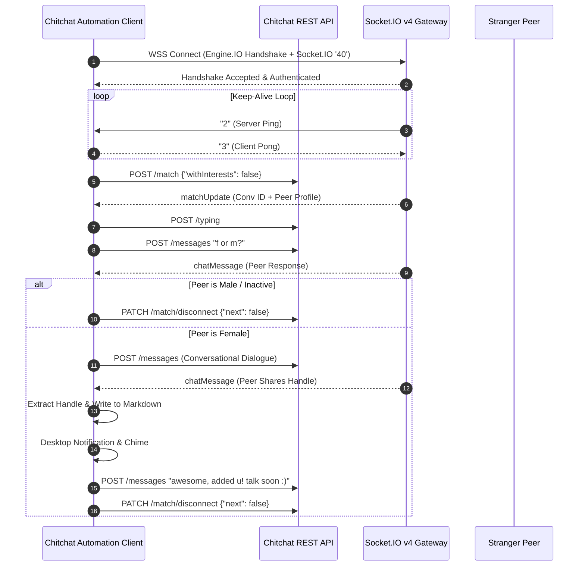

# 🚀 Chitchat Automation Suite

[](https://www.python.org/)
[](https://socket.io/)
[](./docs/endpoints_doc.md)
[](LICENSE)
[](#)

> **A high-performance, event-driven reverse-engineered automation framework and conversational intelligence bot for Chitchat.gg.**
>
> Built entirely on native **Socket.IO v4 WebSockets** and **REST APIs** with zero browser overhead. Filters strangers in milliseconds, screens demographics naturally, handles bidirectional dialogues with realistic typing jitter, and harvests contact handles directly into structured markdown.

---

## ⚡ Highlights & Capabilities

- **Zero-Browser Overhead**: Operates 100% through direct Socket.IO and HTTPS connections. No Chromium or Puppeteer required during operation—achieving sub-second matchmaking cycles with minimal memory usage.
- **Race-Condition Resilient**: Fully decoupled state-machine engine separating `match_event` and `disconnect_event` to prevent false skips, ghost matches, or premature disconnects.
- **Smart Demographic & Intent Classifier**: Fast regex-based natural language parser detecting age, gender declarations (`19f`, `f u?`, `m`, `male`), counter-questions (`wbu`, `u?`), and greetings.
- **Strict Minor Safety Gate**: Instant automatic skips on any underage references (`< 18`) to ensure complete safety and safeguard session integrity.
- **Persona-Driven Dialog Engine**: Converses naturally with realistic human typing delays (`send_typing` simulation), contextual icebreakers, and casual conversational patterns.
- **Contact Extraction & Desktop Alerts**: Automatically parses Instagram handles (`@handle`, `ig: ...`), writes to structured markdown tables, and triggers cross-platform desktop notifications and audio chimes.

---

## 🏗️ System Architecture



---

## 📂 Project Structure

```
chitchat-automation-suite/
├── hunter.py                # 🚀 Main backend hunter & conversation engine
├── chitchat_api.py          # 🔌 Socket.IO v4 & REST client wrapper
├── cookies.json             # 🔑 Active session cookies (Ignored by git)
├── cookies.example.json     # 📄 Template for session cookies
├── girls_instagram.md       # 📋 Harvested contact data store
├── requirements.txt         # 📦 Python package dependencies
├── .gitignore               # 🛡️ Git exclusion rules (safeguards credentials)
├── docs/                    # 📚 Reverse-engineering documentation
│   ├── endpoints_doc.md     # REST & WebSocket specifications
│   ├── endpoints_dump.json  # Raw CDP network trace dump
│   └── texting_patterns.md  # Slang and conversational guide
├── legacy/                  # 📦 Archived Puppeteer UI scripts & experiments
│   ├── inspect/             # UI inspection tools
│   └── tests/               # Experimental tests
└── assets/                  # 🖼️ Project documentation assets
```

---

## 🛠️ Installation & Setup

### 1. Prerequisites
- Python 3.10 or higher
- Valid account or guest session cookies from [chitchat.gg](https://app.chitchat.gg)

### 2. Clone & Install Dependencies
```bash
git clone https://github.com/dulithdivisekara/chitchat-automation-suite.git
cd chitchat-automation-suite
pip install -r requirements.txt
```

### 3. Configure Authentication
Copy the template configuration file:
```bash
cp cookies.example.json cookies.json
```
Populate `cookies.json` with your active Chitchat session cookies:
- `token`: Your account's JWT authorization token.
- `__Secure-text-session`: Session tracking cookie.
- `cf_clearance`: Cloudflare clearance cookie bound to your IP.

---

## 🚀 Usage

### Running the Live Hunter
To start the live background hunter with color-coded terminal output:
```bash
PYTHONUNBUFFERED=1 python3 hunter.py
```

### Terminal Output Preview
```
╔═════════════════════════════════════════════════════════════╗
║     CHITCHAT LIVE BACKEND HUNTER - PERSONA: SAHAN          ║
╚═════════════════════════════════════════════════════════════╝

[*] Goal: Capture 2 girls' Instagram IDs into girls_instagram.md
[*] Persona: Sahan from Sri Lanka (polite, relaxed, friendly)
[*] Mode: 100% Backend API & Real-time WebSocket (Zero UI overhead)

[✓] Authenticated successfully as: SandunLK (ID: 6ae59ec84f15580c26fd612b)
[✓] Real-time Socket.IO connected!

────────────────── [ Match #1 ] ──────────────────
[*] Connected with: @contemporary meriste
[You (Sahan)]: "f or m?"
[@contemporary meriste]: "M"
[⚡ SKIP] Male detected ("M"). Skipping immediately...

────────────────── [ Match #2 ] ──────────────────
[*] Connected with: @chloe_xox
[You (Sahan)]: "f or m?"
[@chloe_xox]: "19f cali"
[💖 CHATTING WITH @chloe_xox] Girl confirmed (19f cali)
[You (Sahan)]: "heyy nice to meet u :) how's everything in Cali?"
[@chloe_xox]: "it's sunny haha where u from?"
[You (Sahan)]: "i'm Sahan, from Sri Lanka! wbu?"
[You (Sahan)]: "btw u seem really sweet haha, u got insta? drop ur @"
[@chloe_xox]: "yeah sure it's @chloe.la"
🎉 INSTAGRAM COLLECTED #1: @chloe.la
🔗 Profile: https://instagram.com/chloe.la
📁 Stored in: girls_instagram.md
```

---

## 📋 Data Output Format

Harvested profiles are logged directly to `girls_instagram.md`:

| # | Instagram Handle | Profile Link | Chitchat Username | Detected Info | Date & Time |
|---|---|---|---|---|---|
| 1 | `@chloe.la` | [chloe.la](https://instagram.com/chloe.la) | @chloe_xox | 19f cali | 2026-11-01 20:05 |

---

## ⚖️ Disclaimer

This repository is created for reverse-engineering research, network protocol analysis, and educational automation experiments. Use responsibly and in accordance with relevant platform Terms of Service.
