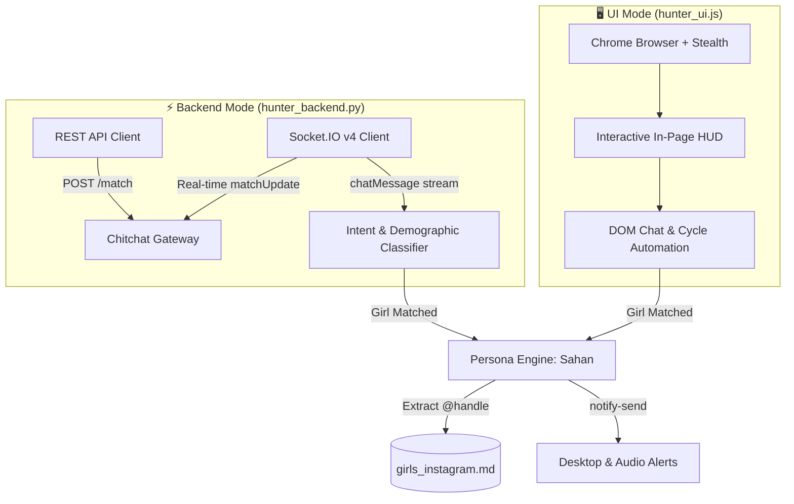

# 🚀 Chitchat Automation Suite

[](https://www.python.org/)
[](https://nodejs.org/)
[](https://socket.io/)
[](#-two-hunting-modes)
[](LICENSE)
[](#)

> **A high-performance dual-mode automation framework and conversational intelligence bot for Chitchat.gg.**
>
> Operates in two distinct modes: a **100% Headless Socket.IO & REST Backend Engine** for blazing sub-second cycles, and an **Interactive Visual UI Browser Bot** with an on-screen HUD overlay for live desktop monitoring and manual takeover.

---

## ⚡ Two Hunting Modes

| Feature | ⚡ Backend Mode (`hunter_backend.py`) | 🖥️ Visual UI Mode (`hunter_ui.js`) |
| :--- | :--- | :--- |
| **Engine** | Python (`requests` + `websockets` Socket.IO v4) | Node.js (`puppeteer-core` with stealth bypass) |
| **Execution** | Pure terminal CLI feed (Color-coded) | Real Chrome browser on screen with in-page HUD |
| **Resource Usage** | Ultra-lightweight (~15 MB RAM, 0% GPU) | Standard browser (~120 MB RAM, GPU rendering) |
| **Matching Speed** | Sub-second instant API matchmaking | Normal browser DOM cycle speed |
| **User Interaction**| Hands-off autonomous background daemon | On-screen HUD buttons: Pause, Next, Manual Takeover |
| **Chat Bot Persona**| Sahan, 20, Sri Lanka (Natural conversationalist)| Sahan, 20, Sri Lanka (Natural conversationalist) |
| **Instagram Harvest**| Automatically saved to `girls_instagram.md` | Automatically saved to `girls_instagram.md` |
| **Alerts** | Audio bell + Desktop notification (`notify-send`)| Audio bell + Desktop notification + Glowing pink HUD |

---

## 🏗️ Architecture & Protocols



---

## 📂 Project Structure

```
chitchat-automation-suite/
├── hunter_backend.py        # ⚡ Dedicated Backend hunter (Python + Socket.IO)
├── hunter_ui.js             # 🖥️ Dedicated Visual UI hunter (Node.js + Puppeteer)
├── hunter.py                # 🔄 Backend runner alias
├── chitchat_api.py          # 🔌 Reverse-engineered Socket.IO v4 & REST client
├── cookies.json             # 🔑 Active session cookies (Protected, in .gitignore)
├── cookies.example.json     # 📄 Template for session cookies
├── girls_instagram.md       # 📋 Harvested contact data store
├── package.json             # 📦 Node dependencies & npm scripts
├── requirements.txt         # 📦 Python package dependencies
├── docs/                    # 📚 Reverse-engineering documentation
│   ├── endpoints_doc.md     # Complete REST & WebSocket API specification
│   └── texting_patterns.md  # Conversational rules and demographic guides
└── legacy/                  # 📦 Internal tests and exploration scripts
```

---

## 🛠️ Installation & Setup

### 1. Prerequisites
- **Python 3.10+** (for Backend mode)
- **Node.js 18+** & Google Chrome (for UI mode)
- Active session cookies from [chitchat.gg](https://app.chitchat.gg)

### 2. Install Dependencies
```bash
# Install Python backend dependencies
pip install -r requirements.txt

# Install Node.js UI dependencies
npm install
```

### 3. Configure Cookies
Copy the sample cookie template:
```bash
cp cookies.example.json cookies.json
```
Populate `cookies.json` with your active cookies:
- `token`: Account JWT authorization token
- `__Secure-text-session`: Active session token
- `cf_clearance`: Cloudflare clearance token

---

## 🚀 Usage

### Option 1: Run Backend Mode (CLI Feed)
Fastest, zero-overhead background execution:
```bash
python3 hunter_backend.py
# or
npm run backend
```

**Terminal Output Preview:**
```
╔═════════════════════════════════════════════════════════════╗
║     CHITCHAT LIVE BACKEND HUNTER - PERSONA: SAHAN          ║
╚═════════════════════════════════════════════════════════════╝

[*] Goal: Capture 2 girls' Instagram IDs into girls_instagram.md
[*] Persona: Sahan from Sri Lanka (polite, relaxed, friendly)
[*] Mode: 100% Backend API & Real-time WebSocket (Zero UI overhead)

[✓] Authenticated successfully as: SandunLK (ID: 6ae59ec84f15580c26fd612b)
[✓] Real-time Socket.IO connected!

────────────────── [ Match #1 ] ──────────────────
[*] Connected with: @contemporary_user
[You (Sahan)]: "f or m?"
[@contemporary_user]: "M"
[⚡ SKIP] Male detected ("M"). Skipping immediately...

────────────────── [ Match #2 ] ──────────────────
[*] Connected with: @chloe_xox
[You (Sahan)]: "f or m?"
[@chloe_xox]: "19f cali"
[💖 CHATTING WITH @chloe_xox] Girl confirmed (19f cali)
[You (Sahan)]: "heyy nice to meet u :) how's everything in Cali?"
[@chloe_xox]: "it's sunny haha where u from?"
[You (Sahan)]: "i'm Sahan, from Sri Lanka! wbu?"
[You (Sahan)]: "btw u seem really sweet haha, u got insta? drop ur @"
[@chloe_xox]: "yeah sure it's @chloe.la"
🎉 INSTAGRAM COLLECTED #1: @chloe.la
🔗 Profile: https://instagram.com/chloe.la
📁 Stored in: girls_instagram.md
```

---

### Option 2: Run UI Mode (On-Screen Browser + HUD)
Visual execution with on-screen interactive control panel:
```bash
node hunter_ui.js
# or
npm run ui
```

*To run UI mode headlessly in background:*
```bash
node hunter_ui.js --headless
# or
npm run ui:headless
```

**On-Screen HUD Features:**
- **Live Status:** Displays real-time matching and filtering state.
- **Counters:** Males Skipped, Girls Matched, Instagrams Captured.
- **Pause / Resume:** Freeze automation to take over conversation at any second.
- **Auto-Bot / Manual:** Toggle between automated bot chat and manual typing.
- **Next (Skip):** Immediately skip to the next stranger.

---

## 📋 Harvested Data Output Format

Harvested profiles are logged directly into [`girls_instagram.md`](./girls_instagram.md):

| # | Instagram Handle | Profile Link | Chitchat Username | Detected Info | Date & Time |
|---|---|---|---|---|---|
| 1 | `@chloe.la` | [chloe.la](https://instagram.com/chloe.la) | @chloe_xox | 19f cali | 2026-11-01 20:05 |

---

## 🛡️ Safety & Anti-Ban Architecture

1. **Decoupled Match & Disconnect States:** Prevents race conditions and null session skips from delayed socket packets.
2. **Minor Protection Gate:** Instant skip upon detecting any underage reference (`< 18`) to ensure user safety and compliance.
3. **Humanized Typing Simulation:** Random jitter and typing indicator (`send_typing`) delays avoid robotic behavior patterns.
4. **Cloudflare Stealth Bypass:** Uses proper browser headers and flags (`--disable-blink-features=AutomationControlled`) to prevent bot detection.

---

## ⚖️ Disclaimer

This repository is created for reverse-engineering research, network protocol analysis, and educational automation experiments. Use responsibly and in accordance with relevant platform Terms of Service.
